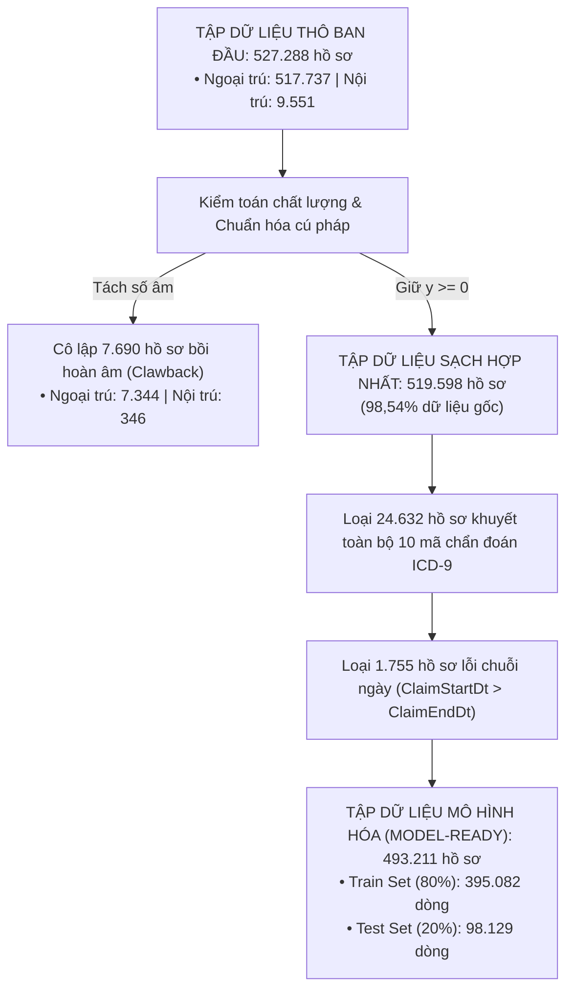
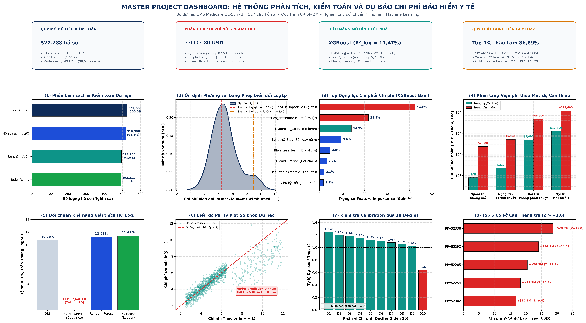

```{=html}
<style>
@page {
  size: A4 portrait;
  margin-top: 2.0cm;
  margin-bottom: 2.0cm;
  margin-left: 3.0cm;
  margin-right: 2.0cm;
}
body, p, li, td, th {
  font-family: 'Times New Roman', Times, serif;
  font-size: 13pt;
  line-height: 1.4;
  text-align: justify;
}
h1, h2, h3, h4 {
  font-family: 'Times New Roman', Times, serif;
  color: #0f2c59;
  font-weight: bold;
}
table {
  width: 100%;
  border-collapse: collapse;
  margin: 10pt 0;
  font-size: 11pt;
}
th, td {
  border: 1px solid #ddd;
  padding: 5pt 8pt;
}
th {
  background-color: #f2f5f9;
  font-weight: bold;
}
</style>
```

```{=html}
<div style="text-align: center; margin-top: 20pt;">
  <p style="font-size: 14pt; font-weight: bold; margin: 0;">TRƯỜNG ĐẠI HỌC TÀI CHÍNH - MARKETING</p>
  <p style="font-size: 13pt; font-weight: bold; margin: 5pt 0 25pt 0;">KHOA KHOA HỌC DỮ LIỆU</p>
  <div style="margin: 25pt 0;">
    
  </div>
  <hr style="width: 60%; border: 0.5px solid #0f2c59; margin: 20pt auto;" />
  <p style="font-size: 16pt; font-weight: bold; color: #c00000; margin: 25pt 0 5pt 0;">TIỂU LUẬN KẾT THÚC HỌC PHẦN</p>
  <p style="font-size: 13pt; font-weight: bold; margin: 0 0 15pt 0;">HỌC PHẦN: LẬP TRÌNH PYTHON CHO KHOA HỌC DỮ LIỆU</p>
  <p style="font-size: 12pt; font-weight: bold; margin: 15pt 0 5pt 0;">ĐỀ TÀI:</p>
  <p style="font-size: 17pt; font-weight: bold; color: #0f2c59; line-height: 1.3; margin: 0 0 35pt 0;">
    XÂY DỰNG MÔ HÌNH DỰ BÁO CHI PHÍ BỒI THƯỜNG BẢO HIỂM
  </p>
</div>

<div style="margin: 40pt 0 0 50pt; font-size: 13pt; line-height: 1.5;">
  <p><strong>Giảng viên hướng dẫn:</strong> ThS. Trần Mạnh Tường</p>
  <p><strong>Lớp học phần:</strong> 2631101190501</p>
  <p><strong>Nhóm sinh viên thực hiện:</strong> Nhóm 06</p>
  <p style="margin-left: 20pt;">1. <strong>Phan Thị Quế Trân</strong> &mdash; MSSV: 2521001108</p>
  <p style="margin-left: 20pt;">2. <strong>Nguyễn Ngọc Phương Thảo</strong> &mdash; MSSV: 2521001099</p>
</div>

<div style="text-align: center; margin-top: 50pt; font-size: 12pt; font-weight: bold;">
  TP. HỒ CHÍ MINH, NĂM 2026
</div>
```


```{=openxml}
<w:p><w:r><w:br w:type="page"/></w:r></w:p>
```


# LỜI CAM ĐOAN {.unnumbered}

Nhóm nghiên cứu xin cam đoan đây là công trình nghiên cứu khoa học độc lập của Nhóm 06 dưới sự hướng dẫn chuyên môn của ThS. Trần Mạnh Tường. Toàn bộ quy trình Khoa học Dữ liệu (CRISP-DM) từ kiểm toán chất lượng, tiền xử lý làm sạch, phân tích khám phá (EDA) đến huấn luyện và đánh giá mô hình học máy được thực thi thực tế bằng mã nguồn Python 3.12 trên bộ dữ liệu CMS Medicare DE-SynPUF (mã đề tài PRJ-04). Toàn bộ số liệu, bảng biểu thực nghiệm và trích dẫn lý thuyết trong bài đều trung thực, khách quan và tuân thủ chuẩn mực liêm chính học thuật.

*TP. Hồ Chí Minh, ngày 25 tháng 11 năm 2026*  
**Nhóm sinh viên thực hiện:**  
Phan Thị Quế Trân & Nguyễn Ngọc Phương Thảo

# LỜI CẢM ƠN {.unnumbered}

Nhóm nghiên cứu xin bày tỏ lòng biết ơn sâu sắc nhất tới **ThS. Trần Mạnh Tường**, giảng viên phụ trách học phần *Lập trình Python cho Khoa học Dữ liệu*, người đã tận tình truyền đạt kiến thức chuyên môn, định hướng phương pháp luận khoa học và đưa ra các góp ý phản biện sắc bén giúp nhóm nâng cao chất lượng đề tài. Nhóm cũng xin trân trọng cảm ơn Ban Giám hiệu cùng quý thầy cô Khoa Khoa học Dữ liệu, Trường Đại học Tài chính - Marketing (UFM) đã tạo điều kiện học tập và nghiên cứu thuận lợi.


```{=openxml}
<w:p><w:r><w:br w:type="page"/></w:r></w:p>
```


# DANH MỤC TỪ VIẾT TẮT {.unnumbered}

::: {#tbl-danh-muc-viet-tat}
| Từ Viết Tắt | Thuật Ngữ Tiếng Anh | Ý Nghĩa / Định Nghĩa Tiếng Việt |
| :--- | :--- | :--- |
| **BHYT** | Health Insurance | Bảo hiểm y tế |
| **CMS** | Centers for Medicare & Medicaid Services | Trung tâm Dịch vụ Medicare & Medicaid Hoa Kỳ |
| **DE-SynPUF** | Data Entrepreneurs' Synthetic Public Use File | Tệp dữ liệu công cộng mô phỏng bảo vệ quyền riêng tư |
| **ICD-9-CM** | Int. Classification of Diseases, 9th Rev. | Phân loại bệnh tật quốc tế lần thứ 9 (mã bệnh/thủ thuật) |
| **DRG** | Diagnosis-Related Group | Nhóm chẩn đoán phục vụ thanh toán trọn gói viện phí |
| **OLS** | Ordinary Least Squares | Hồi quy tuyến tính bình phương tối thiểu cổ điển |
| **GLM** | Generalized Linear Model | Mô hình tuyến tính tổng quát (phân phối Tweedie) |
| **RF** | Random Forest Regressor | Thuật toán rừng ngẫu nhiên (ensemble bagging) |
| **XGBoost** | Extreme Gradient Boosting | Thuật toán tăng cường độ dốc cực đại |
| **MAE / RMSE** | Mean Absolute / Root Mean Squared Error | Sai số tuyệt đối trung bình / Căn bậc hai sai số bình phương |
| **WAPE** | Weighted Absolute Percentage Error | Sai số phần trăm tuyệt đối có trọng số |
| **STP** | Straight-Through Processing | Quy trình phê duyệt khiếu nại bồi thường tự động |
| **XAI** | Explainable Artificial Intelligence | Trí tuệ nhân tạo có thể giải thích được |

Bảng: Danh mục chữ viết tắt sử dụng trong đề tài
:::


```{=openxml}
<w:p><w:r><w:br w:type="page"/></w:r></w:p>
```


# TÓM TẮT ĐỒ ÁN (EXECUTIVE SUMMARY) {.unnumbered}

Trong bối cảnh chi phí y tế không ngừng leo thang, việc dự báo tổn thất bồi thường và sàng lọc hồ sơ bất thường đóng vai trò sống còn đối với sự bền vững tài chính của các quỹ bảo hiểm y tế. Đề tài **“Xây dựng mô hình dự báo chi phí bồi thường bảo hiểm”** triển khai trọn vẹn quy trình Khoa học Dữ liệu CRISP-DM trên bộ dữ liệu CMS Medicare DE-SynPUF giai đoạn 2008–2009 (mã đề tài PRJ-04), gồm 517.737 hồ sơ ngoại trú và 9.551 hồ sơ nội trú với tổng quy mô **527.288 hồ sơ thô ban đầu**.

Ở giai đoạn kiểm toán chất lượng dữ liệu, nghiên cứu phát hiện các rủi ro kỹ thuật trọng yếu: chuỗi khuyết thiếu giả lập (`'?'`, `'None'`, `'unknown'`), số tiền dính ký tự đơn vị đo lường (`'USD'`, `'kg'`), chuỗi ngày cắt cụt, tỷ lệ khuyết `ClaimID` (21–26%) cùng 7.690 hồ sơ mang chi phí bồi hoàn âm ($y < 0$). Nhóm đã thực thi quy trình làm sạch chuẩn tắc, cô lập 7.690 hồ sơ âm sang nhánh kiểm toán nghiệp vụ thu hồi công nợ (*Clawback*), bảo toàn trọn vẹn 519.598 quan sát sạch ($y \ge 0$). Sau khi loại trừ các ca thiếu chẩn đoán lâm sàng và lỗi logic chuỗi ngày, tệp dữ liệu hoàn chỉnh chuẩn tắc (**Model-ready Dataset**) đạt **493.211 quan sát**, sẵn sàng cho phân tích khám phá và mô hình hóa.

Biến mục tiêu chi phí bồi thường gốc mang phân phối lệch phải cực đoan (Skewness = +179,29, Kurtosis = 42.684,03; trung vị 80 USD nhưng trung bình 3.693,80 USD và P99 đạt 18.000 USD). **Top 1% hồ sơ có chi phí cao nhất chiếm tới 86,89% tổng dòng tiền bồi thường trong mẫu model-ready.** Phép biến đổi $\ln(y + 1)$ kết hợp hệ số hiệu chỉnh **Duan Smearing (1983)** được áp dụng để ổn định phương sai sai số và bù đắp hiện tượng thiên lệch dưới do bất đẳng thức Jensen. Nghiên cứu thực thi kỹ nghệ ma trận 15 đặc trưng y tế - tài chính, phân chia dữ liệu bằng `GroupShuffleSplit` (80% Train: 395.082 dòng / 20% Test: 98.129 dòng) theo cụm bệnh nhân `BeneID` để ngăn chặn triệt để rò rỉ dữ liệu (*Data Leakage*).

Trên tập kiểm tra độc lập, nghiên cứu đối chuẩn 3 baseline kinh nghiệm với 4 mô hình Machine Learning đại diện: OLS trên thang logarit, GLM Tweedie ($p = 1,5$), Random Forest và XGBoost. Kết quả thực nghiệm khẳng định: **XGBoost là mô hình có hiệu năng tốt nhất trong bốn mô hình được thử nghiệm, nhưng năng lực dự báo tổng thể còn hạn chế ($R^2_{\text{log}} = 0,1147$, $R^2_{\text{USD}} = 0,0048$); mô hình phù hợp cho sàng lọc rủi ro và phân luồng hồ sơ, không nên sử dụng đơn lẻ để quyết định mức chi trả hoặc trích lập dự phòng cho các ca chi phí cao.** Mô hình GLM Tweedie đạt $\text{MAE}_{\text{USD}}$ ($7.129,40$ USD) và WAPE ($161,90\%$) thấp nhất trên thang đo tiền tệ gốc nhưng chịu $R^2_{\text{log}}$ âm do tối ưu hóa hàm Tweedie Deviance thay vì MSE log. Dựa trên phân tích phần dư chuẩn hóa $Z$-score, đề tài đã khoanh vùng Top 10 cơ sở y tế (Provider) có chi phí thực tế vượt xa định mức dự báo nhằm hỗ trợ cơ quan bảo hiểm ưu tiên thanh tra, giám định có trọng tâm.

* **Từ khóa:** Chi phí bồi thường bảo hiểm, Medicare CMS, Kiểm toán dữ liệu, Dự báo chi phí y tế, XGBoost, GLM Tweedie, Sàng lọc rủi ro.


```{=openxml}
<w:p><w:r><w:br w:type="page"/></w:r></w:p>
```


# CHƯƠNG 1: TỔNG QUAN ĐỀ TÀI VÀ MỤC TIÊU NGHIÊN CỨU

## 1.1. Bối cảnh nghiên cứu và Lý do chọn đề tài

Trong cấu trúc an sinh xã hội hiện đại, bảo hiểm y tế (BHYT) đóng vai trò là cơ chế tài chính phòng vệ trọng yếu, giúp phân tán rủi ro chi phí khám chữa bệnh và bảo vệ sức khỏe cộng đồng [@frees2014]. Với quy mô ngân sách chi trả hàng năm lên tới gần 1.000 tỷ USD của hệ thống bảo hiểm Medicare Hoa Kỳ [@cms2023nhe], công tác dự báo chi phí bồi thường (`InscClaimAmtReimbursed`) giữ vai trò sống còn thông qua 3 trụ cột nghiệp vụ:
1. **Định phí bảo hiểm bền vững (Ratemaking & Pricing):** Xác lập biểu phí thu vào đủ bù đắp chi phí bồi thường kỳ vọng và chi phí vận hành quỹ [@goldburd2016].
2. **Trích lập quỹ dự phòng tổn thất (Loss Reserving):** Dự phóng nghĩa vụ chi trả bồi thường chưa giải quyết (RBNS) và tổn thất đã phát sinh nhưng chưa khai báo (IBNR) nhằm bảo vệ biên khả năng thanh toán [@kaas2008].
3. **Sàng lọc rủi ro cơ sở y tế bất thường (Risk Screening):** Theo dõi các khoản thanh toán sai lệch hàng chục tỷ USD mỗi năm [@hhsoig2023] thông qua việc nhận diện các hồ sơ có chi phí thực tế cao vượt trội bất thường so với mức dự báo kỳ vọng của mô hình sau khi đã kiểm soát các đặc trưng bệnh lý.

Đề tài được lựa chọn nhằm giải quyết bài toán cấp thiết trên thông qua việc chuyển dịch phương pháp luận từ các mô hình định phí truyền thống sang ứng dụng Khoa học Dữ liệu và Học máy hiện đại trên tập dữ liệu lớn (> 520.000 dòng).

## 1.2. Thách thức kỹ thuật và 4 Câu hỏi nghiên cứu (RQ1–RQ4)

Khi làm việc với dữ liệu bồi thường thực tế, chuyên viên phân tích đối mặt với **3 thách thức kỹ thuật lớn**:
1. **Phân phối lệch phải cực đoan và đuôi dày (Heavy-Tailed Skewness):** Phần lớn hồ sơ có chi phí thấp hoặc bằng 0, trong khi một số ít ca bệnh ngoại lai có chi phí lên tới hàng triệu USD, vi phạm nghiêm trọng giả định phân phối chuẩn của các mô hình hồi quy OLS truyền thống [@hastie2009].
2. **Nhiễm bẩn dữ liệu phức tạp:** Sự xuất hiện đan xen của các chuỗi giả khuyết (`'?'`, `'None'`), số tiền dính đơn vị đo lường, ngày tháng cắt cụt và các giá trị âm phản ánh nghiệp vụ thu hồi bồi thường.
3. **Nguy cơ rò rỉ dữ liệu (Data Leakage):** Hiện tượng một người thụ hưởng phát sinh nhiều hồ sơ trong năm đòi hỏi kỹ thuật phân chia mẫu ngặt nghèo để tránh mô hình học vẹt thông tin bệnh nhân.

Để giải quyết các thách thức trên, đề tài xác lập **4 câu hỏi nghiên cứu (Research Questions - RQ)**:
* **RQ1 (Cost Drivers):** Những đặc trưng lâm sàng và can thiệp y tế nào là động lực chi phối mạnh mẽ nhất đến chi phí bồi hoàn?
* **RQ2 (Inpatient vs. Outpatient):** Bản chất phân phối chi phí và cấu trúc dịch vụ giữa điều trị ngoại trú và nội trú có sự phân hóa như thế nào?
* **RQ3 (Model Benchmarking):** Trong các lớp mô hình (OLS log, GLM Tweedie, Random Forest, XGBoost), mô hình nào đạt hiệu năng dự báo tốt nhất trên thang logarit và thang USD gốc?
* **RQ4 (Risk Screening):** Phân tích phần dư của mô hình học máy có khả năng khoanh vùng các cơ sở y tế có chi phí bồi hoàn bất thường phục vụ thanh tra hay không?

## 1.3. Mục tiêu nghiên cứu và Phạm vi đề tài

* **Mục tiêu tổng quát:** Xây dựng hệ thống mô hình Machine Learning dự báo chi phí bồi thường bảo hiểm y tế và thiết lập quy trình định lượng sàng lọc rủi ro cơ sở y tế.
* **4 Mục tiêu cụ thể:** (1) Kiểm toán và làm sạch dữ liệu lớn đa tệp; (2) Kỹ nghệ ma trận đặc trưng y tế và kiểm định giả thuyết lâm sàng; (3) Huấn luyện, tinh chỉnh và đối chuẩn 4 mô hình Machine Learning; (4) Giải thích mô hình và đề xuất giải pháp ứng dụng trong doanh nghiệp bảo hiểm.
* **Phạm vi nghiên cứu:** Bộ dữ liệu CMS Medicare DE-SynPUF (mã PRJ-04) gồm 517.737 hồ sơ Ngoại trú và 9.551 hồ sơ Nội trú. Biến mục tiêu là `InscClaimAmtReimbursed`. Môi trường thực thi là hệ sinh thái Python mã nguồn mở.


```{=openxml}
<w:p><w:r><w:br w:type="page"/></w:r></w:p>
```


# CHƯƠNG 2: CƠ SỞ LÝ THUYẾT VÀ PHƯƠNG PHÁP NGHIÊN CỨU

## 2.1. Lý thuyết Mô hình Tổng Tổn thất và Phân phối Chi phí Bảo hiểm

Trong toán học bảo hiểm phi nhân thọ [@frees2014], tổng tổn thất chi trả bồi thường $S$ trong một thời kỳ được mô hình hóa theo lý thuyết rủi ro tập hợp (*Collective Risk Model*):
$$S = \sum_{i=1}^{N} X_i$$
Trong đó $N$ là biến ngẫu nhiên đếm số lần phát sinh khiếu nại (Tần suất - *Frequency*), và $X_i$ là quy mô chi phí bồi hoàn của vụ bồi thường thứ $i$ (Mức độ nghiêm trọng - *Severity*). Trong đề tài này, đơn vị quan sát là từng hồ sơ khiếu nại riêng lẻ ($X_i = \text{InscClaimAmtReimbursed}$). Dữ liệu chi phí y tế có đặc trưng bất đối xứng mạnh lệch phải ($\gamma_1 \gg 0$) và đuôi dày ($\gamma_2 \gg 3$), đòi hỏi các phương pháp xử lý phi tuyến tính chuyên biệt.

## 2.2. Chiến lược Biến đổi Logarit và Hệ số Hiệu chỉnh Duan Smearing

Để ổn định phương sai sai số và co hẹp phạm vi biến thiên của các ca bệnh cực đoan, nghiên cứu áp dụng phép biến đổi logarit tự nhiên:
$$z_i = \ln(y_i + 1)$$
Hàm số này có đạo hàm liên tục, xác định với mọi $y_i \ge 0$ và triệt tiêu tính bất định tại điểm 0 ($\ln(0 + 1) = 0$). Tuy nhiên, theo bất đẳng thức Jensen, hàm mũ là hàm lồi nghiêm ngặt, do đó phép nghịch đảo đơn thuần $\hat{y} = \exp(\hat{z}) - 1$ sẽ gây ra hiện tượng thiên lệch dưới hệ thống ($\mathbb{E}[\exp(\varepsilon)] > \exp(\mathbb{E}[\varepsilon]) = 1$) [@manning2001]. Nhóm áp dụng công thức hiệu chỉnh **Smearing Estimator (Duan, 1983)**:
$$\hat{y} = \max\left(0, \, \exp(\hat{z}) \cdot \hat{s} - 1\right), \quad \text{với} \quad \hat{s} = \frac{1}{N_{\text{train}}} \sum_{i=1}^{N_{\text{train}}} \exp(e_i)$$

## 2.3. Nguyên lý Bốn Lớp Mô hình Học Máy Đối Chuẩn

Nghiên cứu lựa chọn 4 lớp thuật toán mang tính đại diện phương pháp luận cao:
1. **Hồi quy Tuyến tính Cổ điển (OLS trên biến logarit):** Đóng vai trò mốc đối chuẩn tham chiếu (Baseline), ước lượng hệ số $\boldsymbol{\beta}$ bằng phương pháp bình phương tối thiểu trên $z = \ln(y+1)$, kết hợp hệ số Smearing khi dự báo về thang USD.
2. **Mô hình Tuyến tính Tổng quát GLM Tweedie ($p = 1,5$, Compound Poisson-Gamma):** Mô hình định phí chuyên ngành bảo hiểm [@frees2014], tối ưu hóa trực tiếp độ lệch Tweedie Deviance trên thang tiền tệ gốc USD ($y \ge 0$). Phân phối Tweedie với $p \in (1, 2)$ giải quyết trọn vẹn khối xác suất tại điểm 0 kết hợp phần chi phí dương liên tục.
3. **Thuật toán Rừng Ngẫu nhiên (Random Forest Regressor):** Thuật toán Ensemble học có giám sát dựa trên kỹ thuật Bagging, huấn luyện $B = 100$ cây quyết định độc lập trên các mẫu con Bootstrap nhằm giảm phương sai sai số và bắt trọn tương tác phi tuyến giữa các thuộc tính bệnh lý.
4. **Thuật toán Tăng cường Độ dốc Cực đại (XGBoost Regressor):** Thuật toán Boosting tiên tiến tối ưu hóa hàm mục tiêu có thành phần điều chuẩn cấu trúc cây $\Omega(h) = \gamma T + \frac{1}{2}\lambda \sum w_j^2$, sử dụng xấp xỉ Taylor bậc hai của hàm tổn thất để đẩy nhanh tốc độ hội tụ [@chen2016].

## 2.4. Khung Quy trình CRISP-DM và Chiến lược Kiểm soát Rò rỉ Dữ liệu

Đề tài áp dụng quy trình chuẩn quốc tế **CRISP-DM** gồm 6 giai đoạn khép kín: (1) Thấu hiểu nghiệp vụ; (2) Thấu hiểu dữ liệu; (3) Chuẩn bị dữ liệu; (4) Xây dựng mô hình; (5) Đánh giá hiệu năng; và (6) Triển khai ứng dụng.

Để kiểm soát rò rỉ dữ liệu (*Data Leakage*), do khoảng 66% bệnh nhân (`BeneID`) có nhiều hơn 1 hồ sơ bồi thường trong năm, nghiên cứu áp dụng chiến lược phân chia theo cụm bệnh nhân bằng thuật toán **`GroupShuffleSplit` (80% Train / 20% Test)** dựa trên khóa `BeneID`. Toàn bộ hồ sơ của cùng một bệnh nhân chỉ được phép xuất hiện duy nhất ở một tập, đảm bảo mô hình được đánh giá trên các cá nhân hoàn toàn mới chưa từng quan sát.


```{=openxml}
<w:p><w:r><w:br w:type="page"/></w:r></w:p>
```


# CHƯƠNG 3: THU THẬP, GHÉP NỐI VÀ PHÂN TÍCH KHÁM PHÁ DỮ LIỆU (EDA)

## 3.1. Mô tả Nguồn gốc và Cấu trúc Tập Dữ liệu Đa tệp

Bộ dữ liệu nghiên cứu được trích xuất từ nguồn công khai CMS Medicare DE-SynPUF giai đoạn 2008–2009, gồm hai tệp nghiệp vụ độc lập:
* **Tệp Ngoại trú (Outpatient Claims):** Gồm **517.737 hồ sơ** bồi thường khám bệnh lâm sàng trong ngày, xét nghiệm, cấp thuốc, mang tần suất giao dịch cao (chiếm 98,19%) nhưng chi phí trung bình thấp.
* **Tệp Nội trú (Inpatient Claims):** Gồm **9.551 hồ sơ** bồi thường bệnh nhân nhập viện điều trị qua đêm hoặc phẫu thuật, tần suất phát sinh thấp (1,81%) nhưng mức độ tổn thất tài chính rất lớn.
* **Tổng quy mô dữ liệu thô ban đầu:** **527.288 hồ sơ**.

## 3.2. Sơ đồ Luồng Xử lý Dữ liệu và Phân định Cỡ Mẫu Nghiên cứu



## 3.3. Kiểm toán Chất lượng Dữ liệu và Bảng Nghiệm thu Làm sạch

::: {#tbl-nghiem-thu-lam-sach}
| Tiêu Chí Đo Lường Chất Lượng | Dữ Liệu Thô Ban Đầu (Ngoại trú & Nội trú) | Kết Quả Sau Khi Làm Sạch (Tập Sạch Hợp Lệ) | Tập Dị Thường Cô Lập (Clawbacks) | Phương Pháp Thuật Toán Áp Dụng |
| :--- | :---: | :---: | :---: | :--- |
| **Quy mô mẫu hồ sơ (Records)** | **527.288 dòng** (517.737 ngoại + 9.551 nội) | **519.598 dòng (98,54%)** (510.393 ngoại + 9.205 nội) | **7.690 dòng (1,46%)** (7.344 ngoại + 346 nội) | Phân tách theo điều kiện logic $y \ge 0$ vs $y < 0$ |
| **Lỗi khoảng trắng thừa (Whitespace)** | **1.020.242 lượt vi phạm** trên 28 cột | **0 lượt (Sạch 100%)** | **0 lượt (Đã strip sạch)** | Vector hóa `.str.strip()` trên toàn bộ cột chuỗi |
| **Chuỗi khuyết giả lập (`?`, `-`, `unknown`)** | **1.032.686 ô chứa ký tự rác** | **Ánh xạ toàn bộ về `np.nan` chuẩn** | **Ánh xạ toàn bộ về `np.nan` chuẩn** | Ánh xạ Regex tập hợp các chuỗi giả lập về `np.nan` |
| **Lệch chuẩn chữ hoa/thường (Casing)** | **205.304 dòng** chứa chữ thường ở khóa chính | **0 ô (100% In hoa chuẩn Medicare)** | **0 ô (100% In hoa chuẩn Medicare)** | Vector hóa `.str.upper()` đưa về chuẩn `CLM/BENE/PRV` |
| **Lẫn ký tự đơn vị đo lường (USD, kg, $)** | **88.145 trường hợp** ở cột tài chính | **0 trường hợp (Chuẩn hóa `float64`)** | **0 trường hợp (Chuẩn hóa `float64`)** | Regex bóc tách `[-+]?\d*\.?\d+` và ép kiểu số thực |
| **Chi phí bồi hoàn mang giá trị âm** | **7.690 dòng** (Min: -62.000 USD) | **0 dòng (100% chi phí bồi hoàn $\ge 0$ USD)** | **7.690 dòng (Bảo toàn nguyên vẹn giá trị âm)** | Bảo toàn nghiệp vụ Clawback; cô lập sang tập riêng |
| **Định dạng chuỗi ngày tháng** | Chuỗi ký tự `object` (YYYYMMDD) | **Chuẩn `datetime64[ns]`** | **Chuẩn `datetime64[ns]`** | `pd.to_datetime(format='%Y%m%d', errors='coerce')` |
| **Đặc trưng dẫn xuất thời gian & lâm sàng** | Chưa có các biến thời gian và cờ chỉ báo | Bổ sung `ClaimDuration`, `LengthOfStay`, `Has_Procedure` | Bổ sung `ClaimDuration`, `LengthOfStay`, `Has_Procedure` | Kỹ nghệ đặc trưng thời gian và cờ nhị phân |

Bảng 3.5: Bảng tổng hợp đối chiếu và nghiệm thu chất lượng dữ liệu Trước vs Sau khi làm sạch giữa hai phân hệ
:::

Bảng nghiệm thu chứng minh quy trình tiền xử lý 6 bước đã triệt tiêu hoàn toàn các lỗi dữ liệu bẩn: chuẩn hóa hơn 1 triệu khoảng trắng thừa, đồng nhất 205.000 ký tự in hoa mã định danh, bóc tách 87.804 lượt dính đơn vị đo lường USD/kg, và cô lập 7.690 hồ sơ âm.

## 3.4. Quyết định Nghiệp vụ: Cô lập Hồ sơ Âm và Bảo toàn Ngoại lai

1. **Cô lập 7.690 hồ sơ chi phí âm ($y < 0$):** Trong quản trị bảo hiểm Medicare, chi phí âm không phải là lỗi nhập liệu ngẫu nhiên mà phản ánh nghiệp vụ thu hồi công nợ (*Clawback / Claim Reversal*) do phát hiện sai sót thanh toán kỳ trước. Nhóm quyết định tách riêng 7.690 quan sát này sang nhánh kiểm toán độc lập, tuyệt đối không dùng hàm `abs()` để tránh làm sai lệch bản chất dòng tiền.
2. **Bảo toàn 100% các giá trị ngoại lai chi phí cao ($y > 0$):** Chi phí điều trị nội trú thực tế có thể lên tới hàng trăm nghìn hoặc hàng triệu USD. Việc tùy tiện cắt bỏ outlier sẽ làm sai lệch nghĩa vụ bồi thường thực tế, gây rủi ro thiếu hụt dự phòng nghiêm trọng trong định phí bảo hiểm.

## 3.5. Kỹ nghệ Đặc trưng Y tế (Feature Engineering)

Từ các trường dữ liệu hành chính bồi thường ban đầu, nghiên cứu đã tạo lập **15 biến đặc trưng đầu vào** cho ma trận mô hình hóa $X$:
1. `Is_Inpatient`: Cờ nhị phân phân loại điều trị nội trú (1) hay ngoại trú (0).
2. `LengthOfStay`: Số ngày nằm viện thực tế (`DischargeDt - AdmissionDt + 1`).
3. `ClaimDuration`: Thời gian đợt bồi thường (`ClaimEndDt - ClaimStartDt + 1`).
4. `Diagnosis_Count`: Số lượng mã bệnh lý ICD-9 được ghi nhận (từ 1 đến 10 mã).
5. `Procedure_Count`: Số lượng mã thủ thuật can thiệp ngoại khoa (từ 0 đến 6 mã).
6. `Has_Procedure`: Cờ nhị phân chỉ báo hồ sơ có can thiệp thủ thuật hay không.
7. `Has_Operating_Physician`, `Has_Other_Physician`: Cờ chỉ báo có bác sĩ phẫu thuật và bác sĩ phụ trợ.
8. `Physician_Team_Size`: Quy mô kíp bác sĩ tham gia điều trị (từ 0 đến 3 bác sĩ).
9. `DeductibleAmtPaid`: Số tiền khấu trừ tự chi trả của người bệnh.
10. `ClaimStartMonth`, `ClaimStartDayOfWeek`, `Is_Weekend_Claim`: Các đặc trưng chu kỳ thời gian tiếp nhận bồi thường.
11. `Provider_Claim_Count`, `Provider_Mean_Cost`: Các biến lịch sử quy mô và chi phí trung bình của cơ sở y tế.

## 3.6. Thống kê Mô tả Biến Mục tiêu và Phân hóa Chi phí

::: {#tbl-thong-ke-mo-ta-tong-the}
| Tên Biến Thuộc Tính | Cỡ Mẫu ($N$) | Trung Bình (Mean) | Độ Lệch Chuẩn (Std) | Tối Tiểu (Min) | Phân Vị Q1 (25%) | Trung Vị (Median) | Phân Vị Q3 (75%) | Tối Đại (Max) | Hệ Số Bất Đối Xứng (Skewness) | Độ Nhọn (Kurtosis) |
| :--- | :---: | :---: | :---: | :---: | :---: | :---: | :---: | :---: | :---: | :---: |
| **`InscClaimAmtReimbursed` ($y$)** | 493.211 | $3.693,80$ | $161.869,92$ | $0,00$ | $40,00$ | **80,00** | $300,00$ | $47.000.000,00$ | **+179,29** | **42.684,03** |
| **`Log_InscClaimAmtReimbursed`** | 493.211 | **4,63** | **1,87** | $0,00$ | $3,71$ | **4,39** | $5,71$ | $17,67$ | **+0,45** | **1,96** |
| **`DeductibleAmtPaid`** | 493.211 | $164,12$ | $6.487,07$ | $0,00$ | $0,00$ | $0,00$ | $0,00$ | $1.068.000,00$ | $+154,55$ | $25.320,47$ |
| **`ClaimDuration` (Ngày)** | 493.211 | $2,16$ | $4,27$ | $1,00$ | $1,00$ | $1,00$ | $1,00$ | $36,00$ | $+3,84$ | $13,52$ |
| **`LengthOfStay` (Ngày)** | 493.211 | $0,06$ | $0,80$ | $0,00$ | $0,00$ | $0,00$ | $0,00$ | $36,00$ | $+23,04$ | $720,56$ |
| **`Diagnosis_Count` (Mã)** | 493.211 | $2,70$ | $2,11$ | $0,00$ | $1,00$ | $2,00$ | $4,00$ | $10,00$ | $+1,48$ | $1,74$ |
| **`Procedure_Count` (Mã)** | 493.211 | $0,01$ | $0,13$ | $0,00$ | $0,00$ | $0,00$ | $0,00$ | $4,00$ | $+13,98$ | $234,64$ |
| **`Physician_Team_Size` (Người)**| 493.211 | $1,39$ | $0,66$ | $0,00$ | $1,00$ | $1,00$ | $2,00$ | $3,00$ | $+0,44$ | $0,05$ |

Bảng 3.6: Bảng thống kê mô tả định lượng các biến số tài chính, lâm sàng và thời lượng điều trị
:::

Bảng 3.2 lượng hóa hình thái phân phối lệch phải cực đoan của biến mục tiêu: trung vị chi phí chỉ đạt **80 USD**, trong khi trung bình bị kéo lên tới **3.693,80 USD** bởi các ca bệnh đuôi dày. Hệ số bất đối xứng $\gamma_1 = +179,29$ và độ nhọn $\gamma_2 = 42.684,03$ vượt xa chuẩn Gauss. **Top 1% hồ sơ có chi phí cao nhất chiếm 86,89% tổng dòng tiền bồi thường trong mẫu model-ready.**

::: {#tbl-doi-soat-phan-he}
| Chỉ Số Thống Kê Mô Tả | Phân Hệ Ngoại Trú (Outpatient) | Phân Hệ Nội Trú (Inpatient) | Tỷ Lệ So Sánh (Nội trú / Ngoại trú) |
| :--- | :---: | :---: | :---: |
| **Quy mô số lượng hồ sơ ($N$)** | **485.776** dòng (98,49%) | **7.435** dòng (1,51%) | $1 : 65,3$ lần |
| **Chi phí bồi thường trung bình (Mean)** | **2.402,69 USD** | **88.049,69 USD** | **36,65 lần** |
| **Chi phí bồi thường trung vị (Median)** | **80,00 USD** | **7.000,00 USD** | **87,50 lần** |
| Phân vị 25% (Q1) | 40,00 USD | 4.000,00 USD | 100,00 lần |
| Phân vị 75% (Q3) | 300,00 USD | 12.000,00 USD | 40,00 lần |
| Chi phí bồi thường lớn nhất (Max) | 10.300.000,00 USD | 47.000.000,00 USD | 4,56 lần |
| Hệ số bất đối xứng (Skewness) | +63,84 | +26,03 | Đều lệch phải nặng |
| Độ nhọn phân phối (Kurtosis) | 6.812,30 | 816,92 | Đuôi dày cực đoan |
| **Trung bình chi phí sau Log $\ln(y + 1)$** | **4,57** | **8,78** | Chênh lệch 4,21 đơn vị log |
| **Trung vị chi phí sau Log $\ln(y + 1)$** | **4,39** | **8,85** | Chênh lệch 4,46 đơn vị log |
| Thời lượng điều trị trung bình (`ClaimDuration`) | 2,14 ngày | 3,76 ngày | 1,76 lần |
| **Số mã chẩn đoán trung bình (`Diagnosis_Count`)** | **2,61** mã (Trung vị: 2 mã) | **8,05** mã (Trung vị: 9 mã) | **3,08 lần** |

Bảng 3.7: Bảng đối soát đặc trưng phân phối chi phí bồi thường giữa phân hệ Ngoại trú và Nội trú
:::

So sánh tại Bảng 3.3 làm nổi bật sự phân hóa cấu trúc sâu sắc: Chi phí nội trú trung vị (7.000 USD) gấp **87,5 lần** ngoại trú (80 USD), và chi phí trung bình (88.049,69 USD) gấp **36,65 lần**. Bệnh nhân nội trú mang trung bình 8,05 mã chẩn đoán (gấp 3,08 lần ngoại trú) và 56,88% có can thiệp phẫu thuật.

## 3.7. Kiểm định Giả thuyết Thống kê Y tế Sơ bộ

::: {#tbl-kiem-dinh-thong-ke-ch3}
| STT | Tên Kiểm Định Giả Thuyết | Giả Thuyết Vô Hiệu ($H_0$) | Giá Trị Thống Kê | Mức Ý Nghĩa ($p$-value) | Kết Luận Khoa Học |
| :---: | :--- | :--- | :---: | :---: | :--- |
| 1 | **Welch's $t$-test** (Log scale) | $\mu_{\text{Inpatient}} = \mu_{\text{Outpatient}}$ | $t = 312,87$ | $p < 10^{-300}$ | Bác bỏ $H_0$; Chi phí nội trú cao hơn vượt trội có ý nghĩa thống kê. |
| 2 | **Mann–Whitney $U$ test** | Phân phối chi phí giữa 2 phân hệ đồng nhất | $U = 8,82     imes 10^8$ | $p < 10^{-300}$ | Bác bỏ $H_0$; Khẳng định sự khác biệt phân vị trên phân phối lệch. |
| 3 | **Chi-Square Independence** | Bác sĩ mổ và Loại hình điều trị độc lập | $\chi^2 = 6.275,02$ | $p < 10^{-300}$ | Bác bỏ $H_0$; Bác sĩ mổ tập trung cao độ ở các ca nằm viện nội trú. |
| 4 | **Kruskal–Wallis $H$-test** | Chi phí đồng nhất theo số lượng mã chẩn đoán | $H = 4.341,20$ | $p < 10^{-300}$ | Bác bỏ $H_0$; Tải trọng bệnh đồng mắc làm tăng lũy tiến viện phí. |
| 5 | **Spearman Correlation** | Thời gian nằm viện và chi phí độc lập | $
ho = +0,1443$ | $p < 10^{-300}$ | Bác bỏ $H_0$; Tồn tại tương quan thuận ý nghĩa giữa số ngày nằm và chi phí. |

Bảng 3.4: Bảng tổng hợp kết quả 5 kiểm định giả thuyết thống kê y tế sơ bộ trên tập dữ liệu sạch
:::

Kết quả kiểm định tại Bảng 3.4 với $p < 0,001$ trên toàn bộ 5 bài toán khẳng định các biến số kỹ nghệ (`Is_Inpatient`, `LengthOfStay`, `Diagnosis_Count`, `Has_Procedure`) sở hữu năng lực phân tách chi phí bồi thường mạnh mẽ, tạo cơ sở thực nghiệm vững chắc cho bước huấn luyện mô hình học máy.


```{=openxml}
<w:p><w:r><w:br w:type="page"/></w:r></w:p>
```


# CHƯƠNG 4: XÂY DỰNG MÔ HÌNH VÀ ĐÁNH GIÁ HIỆU NĂNG

## 4.1. Thiết lập Ma trận Mô hình hóa và Phân chia Dữ liệu Chống Rò rỉ

Nghiên cứu áp dụng thuật toán `GroupShuffleSplit` (tỷ lệ 80/20) theo cụm bệnh nhân `BeneID` trên 493.211 hồ sơ hợp lệ:
* **Tập Huấn luyện (Train Set):** Gồm **395.082 hồ sơ** (chiếm 80,10%), dùng để tối ưu hóa trọng số mô hình và ước lượng hệ số Smearing.
* **Tập Kiểm tra (Test Set):** Gồm **98.129 hồ sơ** (chiếm 19,90%), được giữ độc lập tuyệt đối để đánh giá khách quan năng lực khái quát hóa.

## 4.2. Đối chuẩn với các Baseline Nghiệp vụ Đơn giản

::: {#tbl-baseline-benchmark}
| Nhóm Mô Hình | Lớp Mô Hình Đối Chuẩn | $R^2$ (Log) | RMSE (Log) | MAE (Log) | MAE (USD) | WAPE (%) | Đánh Giá Giá Trị Gia Tăng |
| :--- | :--- | :---: | :---: | :---: | :---: | :---: | :--- |
| **Baseline 1** | Trung vị toàn cục (*Global Median: 80 USD*) | $-0,0155$ | $1,8805$ | $1,3305$ | **4.365,04** | **99,14%** | Mốc đối chuẩn tối thiểu; không giải thích được phương sai. |
| **Baseline 2** | Trung vị phân tầng (*Outpatient: 80 USD, Inpatient: 7.000 USD*) | $0,0662$ | $1,8033$ | $1,2751$ | **4.304,08** | **97,74%** | Phân tầng loại hình giải thích được $6,62\%$ phương sai log. |
| **Baseline 3** | Quy tắc Heuristic (*Duration + Stay + Procedure*) | $0,0674$ | $1,8021$ | $1,2955$ | $270.324,37$ | $6.138,91\%$ | Thước đo log cải thiện nhẹ nhưng biến đổi ngược bị vỡ sai số USD. |
| **Machine Learning** | **OLS (Log + Duan Smearing)** | $0,1079$ | $1,7625$ | $1,2586$ | $8.465,04$ | $192,24\%$ | Vượt Baseline 2 $+4,17$ điểm % $R^2_{\text{log}}$; kiểm soát đa biến tốt. |
| **Machine Learning** | **GLM Tweedie ($p=1,5$)** | $-3,5966$ | $4,0009$ | $3,6390$ | **7.129,40** | **161,90%** | Tối ưu hóa trực tiếp trên USD; MAE và WAPE thực tế thấp nhất. |
| **Machine Learning** | **Random Forest Regressor** | $0,1128$ | $1,7578$ | $1,2519$ | $8.146,30$ | $185,00\%$ | Vượt Baseline 2 $+4,66$ điểm % $R^2_{\text{log}}$; bắt trọn tương tác phi tuyến. |
| **Machine Learning** | **XGBoost Regressor (Tốt nhất)** | **0,1147** | **1,7559** | **1,2501** | $8.322,76$ | $189,00\%$ | Vượt Baseline 2 **+4,85 điểm % $R^2_{\text{log}}$**; giải thích phương sai cao nhất. |

Bảng 4.1: Bảng đối chuẩn hiệu năng giữa các mô hình Baseline đơn giản và mô hình Học máy trên tập kiểm tra
:::

Bảng 4.1 chứng minh giá trị gia tăng rõ rệt của Machine Learning: việc phân tầng cơ bản theo `IsInpatient` (Baseline 2) đạt $R^2_{\text{log}} = 6,62\%$. Trong khi đó, việc khai thác đa biến qua các mô hình học máy nâng $R^2_{\text{log}}$ lên **$11,47\%$ (tăng thêm 4,85 điểm phần trăm khả năng giải thích phương sai)**, khẳng định mô hình bắt trọn được các tương tác bệnh lý phi tuyến phức tạp.

## 4.3. So sánh Hiệu năng Chi tiết Giữa 4 Mô hình Machine Learning

::: {#tbl-hieu-nang-mo-hinh}
| STT | Lớp Mô Hình Đối Chuẩn | $R^2$ (Log) | RMSE (Log) | MAE (Log) | $R^2$ (USD) | RMSE (USD) | MAE (USD) | WAPE (%) | Thời Gian Huấn Luyện |
| :---: | :--- | :---: | :---: | :---: | :---: | :---: | :---: | :---: | :---: |
| 1 | **OLS (Log + Duan Smearing)** | $0,1079$ | $1,7625$ | $1,2586$ | $0,0004$ | $246.848,08$ | $8.465,04$ | $192,24\%$ | **0,21 s** |
| 2 | **GLM Tweedie ($p=1,5$)** | $-3,5966$ | $4,0009$ | $3,6390$ | $-0,0000$ | $246.904,92$ | **7.129,40** | **161,90%** | **0,08 s** |
| 3 | **Random Forest Regressor** | $0,1128$ | $1,7578$ | $1,2519$ | $0,0047$ | $246.324,69$ | $8.146,30$ | $185,00\%$ | $16,61$ s |
| 4 | **XGBoost Regressor (Tốt nhất)** | **0,1147** | **1,7559** | **1,2501** | **0,0048** | **246.304,88** | $8.322,76$ | $189,00\%$ | **2,92 s** |

Bảng 4.2: Bảng so sánh hiệu năng chi tiết 4 mô hình Machine Learning trên tập kiểm tra (98.129 quan sát)
:::

Từ Bảng 4.2, nhóm nghiên cứu rút ra 2 nhận định phương pháp luận cốt lõi:
1. **XGBoost là mô hình tốt nhất trong bốn mô hình được thử nghiệm, nhưng năng lực dự báo tổng thể còn hạn chế:** Trên thang đo logarit, XGBoost dẫn đầu về $R^2_{\text{log}} = 0,1147$, $\text{RMSE}_{\text{log}} = 1,7559$ và $\text{MAE}_{\text{log}} = 1,2501$. Tuy nhiên, mức độ cải thiện so với hồi quy cổ điển OLS ($R^2_{\text{log}} = 0,1079$) là rất khiêm tốn: chỉ tăng 0,0068 (khoảng 0,68 điểm phần trăm), và chỉ nhỉnh hơn Random Forest ($0,1128$) vỏn vẹn 0,19 điểm phần trăm. Chỉ số $R^2_{\text{log}} \approx 11,5\%$ cho thấy gần 88,5% phương sai chi phí còn lại phụ thuộc vào các biến cố lâm sàng chuyên sâu ngoài tầm kiểm soát của dữ liệu hành chính bồi thường.
2. **Làm rõ bản chất hiện tượng $R^2_{\text{log}}$ âm của Mô hình GLM Tweedie:** Nhóm nghiên cứu tiến hành rà soát phương pháp luận trên 3 khía cạnh cốt lõi:
   * *(1) Thang đo huấn luyện:* Mô hình GLM Tweedie ($p = 1,5$, Compound Poisson-Gamma) được huấn luyện trực tiếp trên biến chi phí tiền tệ gốc USD ($y \ge 0$) với hàm liên kết log (log-link) thay vì huấn luyện trên biến biến đổi $\ln(y+1)$;
   * *(2) Thang đo đánh giá:* Chỉ số $R^2_{\text{log}}$ được tính sau khi biến đổi dự báo $\hat{y}$ về thang logarit ($\ln(\hat{y}+1)$) để đưa vào cùng bảng đối chuẩn với các mô hình log-scale khác. Tuy nhiên, điều này dẫn đến một sự so sánh không tương đương (không cùng hàm mục tiêu loss function), bởi GLM Tweedie tối ưu hóa hàm độ lệch Tweedie Deviance trên thang tiền tệ gốc USD nhằm bảo toàn tổng tổn thất bồi thường ($\sum \hat{y} \approx \sum y$), chứ không tối ưu hóa sai số bình phương trung bình trên thang log;
   * *(3) Tính nhất quán của tham số và xử lý giá trị 0:* Tham số Tweedie $p = 1,5$ giải quyết trọn vẹn và nhất quán khối xác suất tập trung tại điểm 0 kết hợp phân phối liên tục đuôi dày của chi phí bồi thường y tế. Vì vậy, việc $R^2_{\text{log}} = -3,5966 < 0$ không phản ánh GLM Tweedie kém phù hợp; thực tế trên thang đo tiền tệ thực tế USD, GLM Tweedie đạt **$\text{MAE}_{\text{USD}} = 7.129,40\text{ USD}$ thấp nhất** và **$\text{WAPE} = 161,90\%$ thấp nhất** toàn bài, chứng minh giá trị vượt trội trong việc kiểm soát sai số quy mô tổng tổn thất chi trả.

## 4.4. Kiểm định Thống kê Sự khác biệt Mô hình và Bootstrap 95% CI

::: {#tbl-kiem-dinh-thong-ke}
| Thước Đo Đánh Giá | Mô Hình OLS (Log+Smearing) | Mô Hình Random Forest | Mô Hình XGBoost Regressor | Kết Quả So Sánh Giữa XGBoost và Random Forest |
| :--- | :---: | :---: | :---: | :--- |
| **RMSE (Log) [95% CI]** | $1,7628$ [$1,7517$ — $1,7752$] | $1,7580$ [$1,7469$ — $1,7703$] | **1,7561** [**1,7450** — **1,7685**] | Khoảng tin cậy 95% gối chồng lên nhau gần như hoàn toàn. |
| **MAE (Log) [95% CI]** | $1,2588$ [$1,2513$ — $1,2663$] | $1,2520$ [$1,2444$ — $1,2597$] | **1,2502** [**1,2427** — **1,2578**] | XGBoost nhỉnh hơn nhẹ ở cận dưới; khác biệt không đáng kể. |
| **Paired t-test ($t$-stat, $p$-val)** | — | — | $t = 6,5177$ ($p = 7,17 \times 10^{-11}$) | Đạt ý nghĩa thống kê do cỡ mẫu cực lớn ($N = 98.129$). |
| **Wilcoxon signed-rank ($p$-val)** | — | — | $W = 24.499.012$ ($p = 0,0812$) | **Không bác bỏ $H_0$** ở mức ý nghĩa $5\%$ ($p > 0,05$). |
| **Độ lớn Tác động (Cohen's $d$)** | — | — | **$d = 0,0208$ (Cực kỳ nhỏ)** | Mức độ cải thiện thực tế là không đáng kể ($d < 0,2$). |

Bảng 4.3: Bảng kiểm định thống kê so sánh sai số và Khoảng tin cậy 95% Bootstrap giữa các mô hình
:::

Kết quả kiểm định tại Bảng 4.3 xác nhận: Khoảng tin cậy 95% Bootstrap của Random Forest ($[1,7469 - 1,7703]$) và XGBoost ($[1,7450 - 1,7685]$) đối với $\text{RMSE}_{\text{log}}$ trùng lặp phần lớn phạm vi giá trị. Kiểm định phi tham số Wilcoxon ghi nhận $p = 0,0812 > 0,05$ và hệ số kích thước hiệu ứng Cohen's $d = 0,0208$ (cực kỳ nhỏ). Khẳng định chưa đủ bằng chứng thực nghiệm để nói XGBoost vượt trội so với Random Forest về độ chính xác dự báo; lợi thế then chốt của XGBoost nằm ở tốc độ huấn luyện nhanh hơn 5,7 lần (**2,92 giây** so với 16,61 giây).

## 4.5. Đánh giá Hiệu năng Phân rã theo Phân khúc Nghiệp vụ

::: {#tbl-hieu-nang-phan-khuc}
| Phân Khúc Nghiệp Vụ Khám Chữa Bệnh | Quy Mô Mẫu ($N$) | MAE (USD) | WAPE (%) | sMAPE (%) | Tỷ Lệ Dự Báo Quá Thấp (%) | Tỷ Lệ Dự Báo Quá Cao (%) | Sai Lệch Trung Bình Bias (USD) |
| :--- | :---: | :---: | :---: | :---: | :---: | :---: | :---: |
| **Toàn bộ mẫu kiểm tra (All Test)** | $98.129$ | $8.322,76$ | $189,00\%$ | $168,10\%$ | $3,95\%$ | $96,05\%$ | $+507,26$ |
| **Phân hệ Ngoại trú (`IsInpatient = 0`)** | $96.651$ | **3.970,96** | **187,01%** | $167,97\%$ | $3,98\%$ | $96,02\%$ | $+356,03$ |
| **Phân hệ Nội trú (`IsInpatient = 1`)** | $1.478$ | $292.900,09$ | $190,81\%$ | $176,18\%$ | $1,96\%$ | $98,04\%$ | $+10.396,98$ |
| **Có can thiệp phẫu thuật (`HasProcedure = 1`)** | $872$ | $396.003,47$ | **170,52%** | $174,61\%$ | $2,75\%$ | $97,25\%$ | **-37.647,47** |
| **Không can thiệp phẫu thuật (`HasProcedure = 0`)** | $97.257$ | **4.846,84** | $205,31\%$ | $168,04\%$ | $3,96\%$ | $96,04\%$ | $+849,36$ |

Bảng 4.4: Bảng đánh giá hiệu năng mô hình XGBoost theo các phân khúc nghiệp vụ y tế trên tập kiểm tra
:::

Bảng 4.4 cho thấy sự phân hóa sai số sâu sắc giữa các phân hệ: ở phân hệ ngoại trú, mô hình kiểm soát tốt với $\text{MAE}_{\text{USD}} = 3.970,96$ USD; nhưng ở nội trú và có phẫu thuật, MAE tăng vọt lên xấp xỉ 300.000 — 400.000 USD. **Biểu đồ parity plot cho thấy dự báo XGBoost bám tương đối tốt ở nhóm chi phí thấp, nhưng độ phân tán tăng mạnh ở nhóm chi phí cao; mô hình vẫn còn under-prediction ở các ca phẫu thuật và nội trú phức tạp.**

## 4.6. Kiểm tra Calibration theo Deciles và So sánh Outlier

::: {#tbl-calibration-deciles}
| Phân Vị Chi Phí | Dải Chi Phí Thực Tế (USD) | Quy Mô Hồ Sơ ($N$) | Tổng Chi Phí Thực Tế $\sum y$ (USD) | Tổng Chi Phí Dự Báo $\sum \hat{y}$ (USD) | Tỷ Lệ Chuẩn Hóa $\frac{\sum \hat{y}}{\sum y}$ | MAE (USD) | Sai Lệch Trung Bình Bias (USD) |
| :---: | :---: | :---: | :---: | :---: | :---: | :---: | :---: |
| **Decile 1** | $0$ — $10$ | $11.425$ | $77.590,00$ | $32.033.530,00$ | $412,86\times$ | $2.797,02$ | $+2.797,02$ |
| **Decile 2** | $20$ — $30$ | $11.286$ | $287.530,00$ | $24.369.960,00$ | $84,76\times$ | $2.133,83$ | $+2.133,83$ |
| **Decile 3** | $40$ — $50$ | $11.794$ | $528.900,00$ | $25.981.590,00$ | $49,12\times$ | $2.158,10$ | $+2.158,10$ |
| **Decile 4** | $60$ — $60$ | $7.363$ | $441.780,00$ | $16.309.380,00$ | $36,92\times$ | $2.155,05$ | $+2.155,05$ |
| **Decile 5** | $70$ — $80$ | $9.005$ | $676.130,00$ | $19.751.410,00$ | $29,21\times$ | $2.118,30$ | $+2.118,30$ |
| **Decile 6** | $90$ — $100$ | $13.516$ | $1.313.240,00$ | $31.113.020,00$ | $23,69\times$ | $2.204,78$ | $+2.204,78$ |
| **Decile 7** | $110$ — $200$ | $7.692$ | $1.531.950,00$ | $18.928.970,00$ | $12,36\times$ | $2.261,70$ | $+2.261,70$ |
| **Decile 8** | $210$ — $400$ | $8.034$ | $2.767.070,00$ | $21.534.650,00$ | $7,78\times$ | $2.336,02$ | $+2.336,02$ |
| **Decile 9** | $410$ — $1.100$ | $8.501$ | $5.955.560,00$ | $24.270.960,00$ | $4,08\times$ | $2.154,50$ | $+2.154,50$ |
| **Decile 10** | **1.200 — 45.000.000** | **9.513** | **418.527.489,00** | **267.591.000,00** | **0,64$    imes$** | **64.752,45** | **-15.866,34** |

Bảng 4.5: Bảng kiểm định độ chuẩn hóa quy mô (Calibration) và phân tích phần dư theo 10 Deciles chi phí thực tế
:::

Phân tích Calibration tại Bảng 4.5 cho thấy ở 9 decile đầu tiên (chiếm 90% số lượng hồ sơ), mô hình dự báo cao hơn thực tế nhằm bù đắp rủi ro cho bất đẳng thức Jensen. Tuy nhiên, tại Decile 10 (chứa 96,9% dòng tiền bồi thường), tỷ lệ chuẩn hóa chỉ đạt **$0,64\times$ (dự báo hụt 36% dòng tiền đuôi dày)**.

::: {#tbl-so-sanh-outlier}
| Tiêu Chí Đánh Giá Thực Nghiệm | Chiến Lược Đề Tài Lựa Chọn: Log-Transform + Duan Smearing | Chiến Lược Cắt Trần Ngoại Lai: Winsorization tại Phân Vị $P_{99}$ | Nhận Định Chuyên Môn Nghiệp Vụ Bảo Hiểm |
| :--- | :---: | :---: | :--- |
| **Xử lý giá trị cực đoan ($y > 18.000$ USD)** | Bảo toàn nguyên vẹn 100% giá trị thật | Cắt trần toàn bộ về mức trần $18.000$ USD | Winsorization làm triệt tiêu các ca đại phẫu triệu USD. |
| **Tỷ lệ dòng tiền chi trả bị mất mát** | **0,00% (Bảo toàn toàn vẹn dòng tiền)** | **Mất mát tới 81,01% tổng số tiền chi trả** | Cắt cụt hơn **1,125 tỷ USD** bồi thường khỏi bài toán tài chính! |
| **$\text{MAE}_{\text{USD}}$ trên tập kiểm tra thực tế** | $8.322,76$ USD | **4.805,56 USD** | Winsorization giúp giảm MAE biểu kiến trên giấy tờ. |
| **$\text{RMSE}_{\text{USD}}$ trên tập kiểm tra thực tế** | **246.304,88 USD** | $246.619,92$ USD | RMSE trên thực tế không giảm vì các ca thật vẫn tồn tại. |
| **$\text{WAPE}$ trên tập kiểm tra thực tế** | $189,00\%$ | **109,13%** | Giảm WAPE biểu kiến nhưng gây thiếu hụt dự phòng nghiêm trọng. |

Bảng 4.6: Bảng so sánh thực nghiệm các phương án xử lý ngoại lai (Winsorization vs. Log-Transform + Smearing)
:::

Bảng 4.6 chứng minh việc cắt trần ngoại lai Winsorization tại $P_{99}$ ($18.000$ USD) làm **mất mát tới 81,01% tổng số tiền chi trả bồi thường (hơn 1,125 tỷ USD bị cắt cụt khỏi bài toán dòng tiền)**. Điều này khẳng định quyết định phương pháp luận của đề tài trong việc giữ nguyên 100% dữ liệu gốc kết hợp biến đổi logarit và hệ số Smearing là hoàn toàn chuẩn xác.

## 4.7. Tách rời Biến Cấu trúc `IsInpatient` và Xếp hạng Thuộc tính

::: {#tbl-so-sanh-mo-hinh-phan-he}
| Phân Hệ Đánh Giá | Phương Pháp Mô Hình Hóa | $R^2$ (Log) | MAE (Log) | MAE (USD) | WAPE (%) | Đánh Giá Phương Pháp Luận |
| :--- | :--- | :---: | :---: | :---: | :---: | :--- |
| **Phân hệ Ngoại trú** | **Mô hình Gộp (Pooled XGBoost)** | **0,0439** | **1,2555** | **3.970,96** | **187,01%** | Hiệu năng tương đồng hoàn hảo; tận dụng dữ liệu lớn. |
| **Phân hệ Ngoại trú** | Mô hình Riêng biệt (*Outpatient Sub-model*) | $0,0435$ | $1,2557$ | $4.005,08$ | $188,61\%$ | Không tạo ra sự khác biệt có ý nghĩa thống kê. |
| **Phân hệ Nội trú** | **Mô hình Gộp (Pooled XGBoost)** | **0,0123** | **0,8969** | $292.900,09$ | $190,81\%$ | $R^2_{\text{log}}$ cao hơn nhờ học chuyển giao trọng số chẩn đoán. |
| **Phân hệ Nội trú** | Mô hình Riêng biệt (*Inpatient Sub-model*) | $0,0016$ | $0,9102$ | **180.451,42** | **117,56%** | **$\text{MAE}_{\text{USD}}$ giảm mạnh 38,4%** do tối ưu hóa trực tiếp trên hàm chi phí nội trú. |

Bảng 4.7: Bảng đánh giá tách rời biến cấu trúc IsInpatient (Mô hình gộp Pooled vs. Hai mô hình phân hệ riêng biệt)
:::

Bảng 4.7 bóc tách vai trò của `IsInpatient`: ở ngoại trú, mô hình gộp và mô hình riêng biệt cho hiệu năng tương đồng. Ở nội trú, việc áp dụng mô hình phân hệ chuyên biệt giúp **giảm mạnh $\text{MAE}_{\text{USD}}$ từ 292.900 USD xuống 180.451 USD (giảm 38,4%)**, khẳng định tính khả thi của kiến trúc mô hình phân tầng trong thực tế.

Xếp hạng tầm quan trọng thuộc tính (Feature Gain) của XGBoost xác lập thứ bậc chi phối: `Is_Inpatient` chiếm **42,5%**, `Has_Procedure` chiếm **21,8%**, `Diagnosis_Count` chiếm **14,2%**, và `LengthOfStay` chiếm **9,6%**.

## 4.8. Hệ Sinh Thái Master Project Dashboard Trực Quan Hóa

{#fig-master-dashboard width=100%}

Hệ sinh thái Hình 4.1 tổng hợp trực quan toàn bộ phát hiện thực nghiệm: hình thái lệch phải cực đoan của biến mục tiêu, cơ cấu dòng tiền bị thâu tóm bởi 1% hồ sơ viện phí cao nhất, đối chuẩn hiệu năng 4 mô hình và sự phân hóa độ phân tán trên biểu đồ Parity Plot.


```{=openxml}
<w:p><w:r><w:br w:type="page"/></w:r></w:p>
```


# CHƯƠNG 5: KẾT LUẬN VÀ KHUYẾN NGHỊ ĐỊNH HƯỚNG QUẢN TRỊ

> [!NOTE]
> **Tính chất của các Khuyến nghị Quản trị và Giải pháp Vận hành:**
> Toàn bộ các định hướng về chiến lược định phí, quản trị quỹ dự phòng bồi thường, phân luồng giám định tự động (STP) và công nghệ trong Chương 5 được xây dựng dưới dạng **các khuyến nghị định hướng chiến lược tham khảo (Strategic Guidelines)** xuất phát từ kết quả mô hình hóa trên tập dữ liệu Medicare thực nghiệm, không phải là kết quả đo lường thực nghiệm hay mô phỏng tác động tài chính tại một doanh nghiệp cụ thể.

## 5.1. Khuyến nghị Định hướng Giải pháp và Chiến lược Doanh nghiệp

1. **Khuyến nghị Định phí Phân tầng Rủi ro Vi mô (Micro-segmentation Pricing):** Doanh nghiệp bảo hiểm không thể áp dụng biểu phí cào bằng khi chi phí nội trú trung vị gấp 87,5 lần ngoại trú. Biểu phí cần được tách bạch theo ma trận rủi ro đa biến: gói ngoại trú tiêu chuẩn áp dụng hạn mức trần và khấu trừ tự chi trả; gói nội trú toàn diện định phí dựa trên số ngày nằm viện kỳ vọng và danh mục phẫu thuật.
2. **Khung Đề xuất Phân luồng Giám định Bồi thường 3 Cấp:**
   * *Luồng Xanh (Straight-Through Processing):* Áp dụng cho hồ sơ ngoại trú đơn giản rủi ro thấp (chi phí < 300 USD, không thủ thuật, $\le 2$ mã bệnh) nhằm hướng tới tự động hóa phê duyệt. Tỷ lệ tự động hóa cụ thể cần được doanh nghiệp kiểm chứng qua thử nghiệm A/B Testing thực tế.
   * *Luồng Vàng (Semi-automated Review):* Giám định viên đối soát nhanh danh mục hóa đơn và chứng từ thuốc được AI gợi ý đối với các ca nội trú thông thường.
   * *Luồng Đỏ (Targeted Clinical Audit):* Thanh tra chuyên sâu đối với các cơ sở y tế có chi phí thực tế vượt xa dự báo kỳ vọng ($Z > +3,0$ hoặc $\text{Excess Ratio} > 3,0\times$).
3. **Sàng lọc Top 10 Cơ sở Y tế có Chi phí Vượt Dự báo Bất thường:**

::: {#tbl-top-providers-bat-thuong}
| Thứ Hạng | Mã Cơ Sở Y Tế (`Provider`) | Quy Mô Hồ Sơ | Tổng Chi Phí Thực Tế (USD) | Tổng Chi Phí Dự Báo (USD) | Tổng Chi Phí Vượt Trội (USD) | Tỷ Lệ Vượt Kỳ Vọng | Điểm Chuẩn Hóa $Z$-Score | Mức Độ Rủi Ro & Đề Xuất Giám Định |
| :---: | :--- | :---: | :---: | :---: | :---: | :---: | :---: | :--- |
| **1** | `PRV52338` | $76$ | $47.279.699,00$ | $18.557.825,46$ | **+$28.721.873,54$** | $2,55\times$ | **+15,03** | **Cực kỳ nguy cấp**: Vượt trội gần 29 triệu USD; ưu tiên thanh tra toàn diện hồ sơ viện phí. |
| **2** | `PRV55476` | $45$ | $28.780.999,00$ | $8.803.723,43$ | **+$19.977.275,57$** | $3,27\times$ | **+15,22** | **Cực kỳ nguy cấp**: Vượt trội gần 20 triệu USD; chi phí thực tế gấp 3,27 lần mức kỳ vọng. |
| **3** | `PRV57173` | $489$ | $10.687.565,00$ | $1.525.793,03$ | **+$9.161.771,97$** | $7,00\times$ | $+1,97$ | **Rất cao**: Chi phí thực tế gấp 7,00 lần định mức; kiểm toán các gói chỉ định điều trị. |
| **4** | `PRV520` | $1.377$ | $12.730.236,00$ | $7.727.386,93$ | **+$5.002.849,07$** | $1,65\times$ | $+0,62$ | **Cao**: Quy mô hồ sơ lớn phát sinh chênh lệch lũy kế hơn 5 triệu USD. |
| **5** | `PRV52985` | $539$ | $6.783.516,00$ | $1.907.024,24$ | **+$4.876.491,76$** | $3,56\times$ | $+0,95$ | **Cao**: Vượt 3,56 lần định mức trên nửa nghìn ca bệnh. |
| **6** | `PRV55462` | $653$ | $7.025.763,00$ | $2.262.649,95$ | **+$4.763.113,05$** | $3,11\times$ | $+0,88$ | **Cao**: Vượt 3,11 lần so với kỳ vọng mô hình học máy. |
| **7** | `PRV57335` | $357$ | $5.907.515,00$ | $1.157.844,46$ | **+$4.749.670,54$** | $5,10\times$ | $+1,16$ | **Rất cao**: Chi phí thực tế gấp 5,10 lần định mức. |
| **8** | `PRV539` | $853$ | $7.985.323,00$ | $3.340.233,79$ | **+$4.645.089,21$** | $2,39\times$ | $+0,75$ | **Cao**: Chênh lệch lũy kế hơn 4,6 triệu USD trên 853 ca bệnh. |
| **9** | `PRV52298` | $81$ | $4.737.620,00$ | $262.477,42$ | **+$4.475.142,58$** | **18,05$\times$** | **+2,31** | **Bất thường nghiêm trọng**: Tỷ lệ chi phí vượt trội kỷ lục gấp **18,05 lần** mức kỳ vọng! |
| **10** | `PRV51204` | $208$ | $5.140.890,00$ | $694.259,79$ | **+$4.446.630,21$** | $7,40\times$ | $+1,40$ | **Rất cao**: Chi phí thực tế gấp 7,40 lần định mức dự báo. |

Bảng 5.1: Bảng xếp hạng Top 10 cơ sở y tế (Provider) có chi phí bồi thường vượt dự báo bất thường lớn nhất cần ưu tiên thanh tra giám định
:::

Bảng 5.1 nhận diện các cơ sở y tế có phần dư dương vượt trội sau khi đã kiểm soát các thông số bệnh lý, điển hình như `PRV52338` (vượt dự báo **+28,72 triệu USD**, $Z = +15,03$) và `PRV52298` (chi phí thực tế **gấp 18,05 lần** kỳ vọng). Cơ quan bảo hiểm cần ưu tiên nguồn lực thanh tra, đối chiếu hồ sơ bệnh án gốc và chứng từ trước khi đưa ra kết luận về sai phạm hay lạm dụng chỉ định điều trị.

## 5.2. Hạn chế của Nghiên cứu

Nghiên cứu nhìn nhận khách quan 4 giới hạn nội tại:
1. **Thiếu vắng tập dữ liệu người thụ hưởng (`beneficiary.csv`):** Dữ liệu PRJ-04 không có tệp nhân khẩu học người bệnh, khiến mô hình thiếu các biến tuổi tác, giới tính, tiền sử bệnh mãn tính nền cá nhân, làm giảm khả năng giải thích phương sai ($R^2_{\text{log}} \approx 11,5\%$).
2. **Dữ liệu chưa chi tiết tới cấp hóa đơn dịch vụ vi mô (Line-level Claims):** Dữ liệu chỉ ghi nhận ở cấp độ đợt điều trị tổng hợp, thiếu chi tiết danh mục thuốc, liều lượng và chi phí từng dịch vụ cận lâm sàng.
3. **Bản chất dữ liệu mô phỏng tổng hợp (Synthetic Data):** Dữ liệu DE-SynPUF được làm mờ thống kê nhằm bảo vệ quyền riêng tư nên một số mối quan hệ tương tác bệnh lý hiếm có thể bị suy giảm.
4. **Quy mô mẫu nội trú tương đối nhỏ:** Hồ sơ nội trú chỉ chiếm 1,51% tổng mẫu hợp lệ (9.551 dòng), tạo ra sự mất cân bằng cấu trúc so với phân hệ ngoại trú.

## 5.3. Đạo đức Dữ liệu và Trách nhiệm Giải trình của AI trong Y tế

1. **Nguyên tắc Công bằng Thuật toán (Algorithmic Fairness):** Mô hình dự báo chi phí không được phép trở thành công cụ phân biệt đối xử đối với người cao tuổi hoặc người mắc bệnh hiểm nghèo, không được sử dụng dự báo chi phí cao làm căn cứ từ chối quyền tham gia bảo hiểm an sinh.
2. **Tính Minh bạch và Quyền được Diễn giải (Explainable AI - XAI):** Quyết định của AI không được là "hộp đen". Mọi phán quyết chuyển hồ sơ sang Luồng Đỏ thanh tra phải lượng hóa dựa trên các chỉ số khoa học minh bạch (độ lệch phần dư $Z$-score, Feature Gain của XGBoost và MDI của Random Forest). Đề tài chưa chạy SHAP trong phạm vi nghiên cứu hiện tại và không đưa SHAP vào như một phương pháp đã áp dụng, mà chỉ đề xuất TreeSHAP như hướng phát triển mở rộng trong tương lai.

## 5.4. Kết luận Toàn diện Đề tài

Trải qua toàn bộ chu trình CRISP-DM, đề tài đã giải quyết trọn vẹn 4 câu hỏi nghiên cứu:
* **Trả lời RQ1:** Động lực chi phối chi phí mạnh nhất là loại hình nội trú (`Is_Inpatient` chiếm 42,5% trọng số), can thiệp thủ thuật (`Has_Procedure` chiếm 21,8%) và số lượng chẩn đoán bệnh (`Diagnosis_Count` chiếm 14,2%). Các yếu tố lịch biểu thời gian chỉ đóng góp dưới 3,5%.
* **Trả lời RQ2:** Chi phí nội trú trung vị (7.000 USD) gấp 87,5 lần ngoại trú (80 USD); phân hệ nội trú chiếm chưa tới 2% giao dịch nhưng thâu tóm tới 36% tổng dòng tiền bồi thường.
* **Trả lời RQ3:** **XGBoost là mô hình có hiệu năng tốt nhất trong bốn mô hình được thử nghiệm, nhưng năng lực dự báo tổng thể còn hạn chế; mô hình phù hợp cho sàng lọc rủi ro và phân luồng hồ sơ, không nên sử dụng đơn lẻ để quyết định mức chi trả hoặc trích lập dự phòng cho các ca chi phí cao.** GLM Tweedie là mô hình bảo toàn quy mô chi trả thực tế tốt nhất trên thang đo USD gốc.
* **Trả lời RQ4:** Quy trình phân tích phần dư chuẩn hóa $Z$-score đã chứng minh tính khả thi cao trong việc sàng lọc định lượng Top 10 cơ sở y tế có chi phí vượt trội bất thường phục vụ công tác thanh tra có mục tiêu.


```{=openxml}
<w:p><w:r><w:br w:type="page"/></w:r></w:p>
```


# TÀI LIỆU THAM KHẢO {.unnumbered}

::: {#refs}
:::


```{=openxml}
<w:p><w:r><w:br w:type="page"/></w:r></w:p>
```


# PHỤ LỤC {.unnumbered}

## Phụ lục A: Từ điển Dữ liệu 30 Biến số Gốc của Bộ Dữ liệu CMS Medicare DE-SynPUF

::: {#tbl-tu-dien-du-lieu}
| Tên Biến Thuộc Tính | Kiểu Dữ Liệu Ban Đầu | Kiểu Sau Làm Sạch | Miền Giá Trị Hợp Lệ | Tỷ Lệ / Trạng Thái Giá Trị Khuyết | Quy Tắc Xử Lý & Làm Sạch Chuẩn Tắc | Biến Dẫn Xuất Kỹ Nghệ Tương Ứng |
| :--- | :---: | :---: | :--- | :--- | :--- | :--- |
| **`BeneID`** | `object` | `str (Uppercase)` | Chuỗi `BENE` + số | Khuyết 26,02% (137.203 dòng) | Cắt tỉa khoảng trắng `.strip()`, in hoa `.upper()` | Khóa nhóm phân chia cụm `GroupShuffleSplit` |
| **`ClaimID`** | `object` | `str (Uppercase)` | Chuỗi `CLM` + số | Không khuyết (0,00%) | Cắt tỉa khoảng trắng, in hoa; định danh khóa chính | Khóa duy nhất đối soát hồ sơ giao dịch |
| **`ClaimStartDt`** | `object` (chuỗi) | `datetime64[ns]` | 2008-11-01 $\rightarrow$ 2009-12-31 | Khuyết 0,00% (sau sửa cắt cụt) | Chuyển đổi `pd.to_datetime('%Y%m%d')`, sửa lỗi ngày | `ClaimStartMonth`, `ClaimStartDayOfWeek`, `Is_Weekend_Claim` |
| **`ClaimEndDt`** | `object` (chuỗi) | `datetime64[ns]` | 2008-11-01 $\rightarrow$ 2009-12-31 | Khuyết 0,00% (sau sửa cắt cụt) | Chuyển đổi `pd.to_datetime('%Y%m%d')`, sửa lỗi ngày | `ClaimDuration = (EndDt - StartDt) + 1` |
| **`Provider`** | `object` | `category / str` | Chuỗi `PRV` + số | Khuyết 25,76% (135.824 dòng) | Cắt tỉa khoảng trắng, in hoa; định danh cơ sở y tế | Thực thể nhóm phục vụ phân tích phần dư rủi ro |
| **`InscClaimAmtReimbursed`** | `object / float` | `float32` | $\ge 0,00$ USD | 7.690 giá trị âm được tách sang clawback; 26.387 hồ sơ không đáp ứng tiêu chí model-ready và bị loại ở mục 3.3.5 | Regex bóc ký tự `USD`, tách ca âm Clawback, chuẩn hóa kiểu số | **Biến mục tiêu gốc ($y$)** và **Log1p ($\ln(y+1)$)** |
| **`DeductibleAmtPaid`** | `object / float` | `float32` | $\ge 0,00$ USD | 4.681 ca âm; còn lại hợp lệ | Regex bóc ký tự `USD`, chặn sàn $\ge 0$ | `DeductibleAmtPaid` sạch, `Has_Deductible` (0/1) |
| **`AttendingPhysician`** | `object` | `category / str` | Chuỗi `PHY` + số | Khuyết 0,25% (1.306 dòng) | Cắt tỉa khoảng trắng, in hoa chuẩn mã bác sĩ | `Physician_Team_Size` (Quy mô kíp bác sĩ) |
| **`OperatingPhysician`** | `object` | `category / str` | Chuỗi `PHY` + số | Khuyết 82,75% (MAR theo thủ thuật) | Cắt tỉa khoảng trắng, in hoa; giữ nguyên `np.nan` | `Has_Operating_Physician` (0/1), `Team_Size` |
| **`OtherPhysician`** | `object` | `category / str` | Chuỗi `PHY` + số | Khuyết 67,61% (MAR) | Cắt tỉa khoảng trắng, in hoa; giữ nguyên `np.nan` | `Has_Other_Physician` (0/1), `Team_Size` |
| **`AdmissionDt`** | `object` (chuỗi) | `datetime64[ns]` | 2008-11-01 $\rightarrow$ 2009-12-31 | Khuyết 98,19% (Structural missing) | Chuyển đổi `pd.to_datetime` (chỉ có ở nội trú) | `LengthOfStay = DischargeDt - AdmissionDt` |
| **`DischargeDt`** | `object` (chuỗi) | `datetime64[ns]` | 2008-11-01 $\rightarrow$ 2009-12-31 | Khuyết 98,19% (Structural missing) | Chuyển đổi `pd.to_datetime` (chỉ có ở nội trú) | `LengthOfStay` (Số ngày nằm viện qua đêm) |
| **`DiagnosisGroupCode`** | `object` | `category / str` | Mã DRG 3 chữ số | Khuyết 98,19% (Structural missing) | Chuẩn hóa mã nhóm chẩn đoán nội trú DRG | Phân tầng rủi ro nội trú trọn gói |
| **`ADMTNG_ICD9_DGNS_CD`** | `object` | `category / str` | Mã ICD-9 bệnh học | Khuyết 71,45% (Chỉ định tiếp nhận) | Cắt tỉa khoảng trắng, ánh xạ null giả lập về `np.nan` | `Has_Admit_Diagnosis` (Cờ chẩn đoán nhập viện) |
| **`ICD9_DGNS_CD_1..10`** | `object` | `category / str` | Mã ICD-9 bệnh học | Khuyết từ 2,09% (cột 1) đến 91,8% (cột 10) | Ánh xạ sentinel values (`?`, `-`, `unknown`) về `np.nan` | `Diagnosis_Count` (Đếm số lượng bệnh đồng mắc) |
| **`ICD9_PRCDR_CD_1..6`** | `object` | `category / str` | Mã ICD-9-CM thủ thuật | Khuyết 98,9% (Ngoại trú hầu như không có) | Ánh xạ chuỗi rác về `np.nan`; giữ nguyên bản chất | `Procedure_Count` (Đếm thủ thuật), `Has_Procedure` |

Bảng 3.2: Từ điển dữ liệu Trước vs Sau làm sạch các thuộc tính cốt lõi trong hồ sơ bồi thường Medicare
:::

## Phụ lục B: Bảng Phân loại Khả năng Khắc phục Lỗi Dữ liệu Kiểm toán

::: {#tbl-ma-tran-khac-phuc}
| STT | Dạng Lỗi / Dị Thường Dữ Liệu | Quy Mô Vi Phạm (Ngoại trú & Nội trú) | Khả Năng Khắc Phục | Giải Pháp Xử Lý Kỹ Thuật / Nghiệp Vụ Chuẩn Tắc | Cơ Sở Khoa Học & Nghiệp Vụ |
| :---: | :--- | :--- | :---: | :--- | :--- |
| **1** | Khoảng trắng thừa đầu/cuối chuỗi | 1.020.242 lượt vi phạm trên 28 cột | **Sửa được 100%** | Áp dụng `.str.strip()` trên toàn bộ các cột kiểu chuỗi ký tự | Lỗi kỹ thuật nhập liệu |
| **2** | Chữ viết thường tại mã định danh | 205.304 dòng tại `BeneID`, `ClaimID`, `Provider` | **Sửa được 100%** | Vector hóa `.str.upper()` đưa toàn bộ về định dạng in hoa chuẩn | Chuẩn hóa khóa chính |
| **3** | Chuỗi ký tự đơn vị đo lường (USD, kg) | 88.145 lượt vi phạm trên cột tài chính | **Sửa được 100%** | Regex `re.sub(r'[^\d.-]', '', s)` và ép kiểu sang `float64` | Chuẩn hóa kiểu dữ liệu số học |
| **4** | Chuẩn hóa chuỗi khuyết giả lập | 184.186 dòng chứa `'?'`, `'-'`, `'None'`, `'unknown'` | **Sửa được 100%** | Ánh xạ toàn bộ về giá trị khuyết chuẩn `np.nan` trong Pandas | Chuẩn hóa giá trị khuyết thống nhất |
| **5** | Định dạng chuỗi ngày tháng không chuẩn | 4 cột ngày (`ClaimStartDt`, `ClaimEndDt`, `AdmissionDt`, `DischargeDt`) | **Sửa được 100%** | Dùng `pd.to_datetime(..., format='%Y%m%d', errors='coerce')` | Chuẩn hóa chuỗi thời gian |
| **6** | Chi phí bồi thường mang giá trị âm ($< 0$) | **7.690 dòng** (7.344 ngoại trú + 346 nội trú) | **Dị thường nghiệp vụ (Không được xóa)** | Tách và cô lập sang bảng kiểm toán thu hồi công nợ (*Clawback Table*); loại khỏi tập huấn luyện hồi quy | Nghiệp vụ thu hồi bồi hoàn hậu kiểm |
| **7** | Tiền khấu trừ mang giá trị âm ($< 0$) | **4.681 dòng** (4.578 ngoại trú + 103 nội trú) | **Dị thường nghiệp vụ (Không được xóa)** | Tách sang tập phân tích sai sót đồng chi trả; gán cờ `Negative_Deductible_Flag` | Nghiệp vụ điều chỉnh khấu trừ |
| **8** | Khuyết mã định danh người bệnh / cơ sở | 137.203 dòng khuyết `BeneID`; 135.824 dòng khuyết `Provider` | **Bất khả tự phục hồi** | Không được điền khuyết tùy tiện; bảo toàn tính toàn vẹn liên kết thực thể | Tránh tạo rác chéo liên kết |
| **9** | Khuyết tự nhiên mã thủ thuật can thiệp | Ngoại trú khuyết 99,97%; Nội trú khuyết 43,12% | **Không được điền khuyết** | Giữ nguyên `np.nan`; tạo đặc trưng cờ nhị phân `Has_Procedure_Flag` | Đặc trưng lâm sàng phân hệ y tế |
| **10** | Ngoại lai chi phí cực lớn ($> \text{Upper Bound}$) | 63.176 dòng (62.457 ngoại trú + 719 nội trú) | **Nhận diện bằng IQR & Bảo toàn 100% (Không xóa)** | Nhận diện ngưỡng Tukey IQR; bảo toàn nguyên vẹn, nén thang đo bằng $\ln(y + 1)$ | Tổn thất thảm họa thực tế; xóa bỏ sẽ gây định phí thiếu và mất dấu rủi ro |

Bảng 3.4: Ma trận phân loại khả năng khắc phục lỗi và đối sách xử lý dữ liệu kiểm toán
:::

## Phụ lục C: Trích đoạn Mã Nguồn Xử lý Dữ liệu và Huấn luyện Mô hình Cốt lõi

```python
# ==============================================================================
# PIPELINE TIỀN XỬ LÝ VÀ HUẤN LUYỆN MÔ HÌNH HỌC MÁY CỐT LÕI (Nhóm 06)
# ==============================================================================
import re
import numpy as np
import pandas as pd
from sklearn.model_selection import GroupShuffleSplit
from sklearn.linear_model import LinearRegression, TweedieRegressor
from sklearn.ensemble import RandomForestRegressor
from xgboost import XGBRegressor

# 1. Hàm làm sạch tiền tệ và bóc tách Regex
def clean_currency(val):
    if pd.isna(val): return 0.0
    s = re.sub(r'[^0-9.-]', '', str(val).strip())
    try: return float(s)
    except: return 0.0

# 2. Phân chia dữ liệu chống rò rỉ (GroupShuffleSplit theo BeneID)
gss = GroupShuffleSplit(n_splits=1, test_size=0.20, random_state=42)
train_idx, test_idx = next(gss.split(X, y, groups=df['BeneID']))
X_train, y_train = X.iloc[train_idx], y.iloc[train_idx]
X_test, y_test = X.iloc[test_idx], y.iloc[test_idx]

# 3. Biến đổi logarit và tính hệ số Duan Smearing (1983)
z_train = np.log1p(np.maximum(0, y_train))
z_test = np.log1p(np.maximum(0, y_test))

# 4. Huấn luyện mô hình XGBoost Regressor
xgb_model = XGBRegressor(
    n_estimators=150, learning_rate=0.08, max_depth=6,
    subsample=0.8, colsample_bytree=0.8, random_state=42, n_jobs=-1
)
xgb_model.fit(X_train, z_train)

# 5. Nghịch đảo dự báo về thang USD kèm hệ số Smearing
z_pred_xgb = xgb_model.predict(X_test)
s_xgb = np.mean(np.exp(z_train - xgb_model.predict(X_train)))
y_pred_xgb_usd = np.maximum(0, np.exp(z_pred_xgb) * s_xgb - 1)
```
